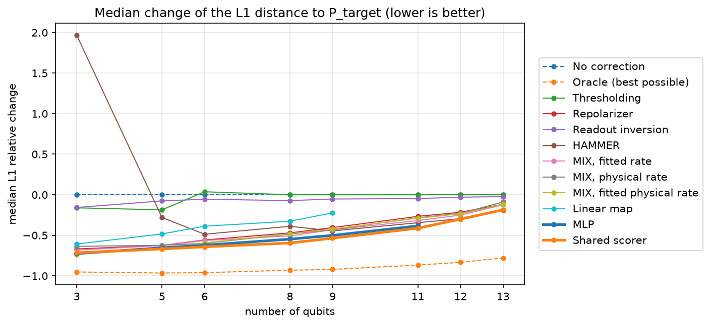

# DEQUBIT

Sequence-to-sequence denoising of quantum measurement bitstrings for scalable error
mitigation.


Status: models, baselines, training and evaluation implemented; results on the
validation circuits of 3 to 13 qubits. The Streamlit demo is not implemented yet.

## Problem

Quantum computers return their results as measured bitstrings, and hardware noise
corrupts many of these measurements. Deep learning can turn a noisy output distribution
into the ideal one [1], but a distribution over n qubits has 2^n entries, so this does
not scale.

DEQUBIT corrects single bitstrings instead. The model reads one noisy measured
bitstring and chooses a small correction for it: keep it, or flip one or two bits. The
corrected shots of a circuit form the mitigated distribution. The number of possible
corrections grows with the square of the number of qubits instead of exponentially.

## Team

Mentor: Yuriy Pryyma.

| Name | GitHub | Role |
|---|---|---|
| Kateryna Suchok | [fro-og](https://github.com/fro-og) | Circuit and data generation, noise simulation, preprocessing, EDA |
| Roman Prokhorov | [MunenNoKage](https://github.com/MunenNoKage) | Models, action space, training, baselines, evaluation |

## Approach

```text
shots of a circuit -> shot counts -> model -> P(action | bitstring) for every measured bitstring
every shot moved by its action -> corrected distribution -> KL loss against P_target
```

- **Actions.** An action XORs a mask into the shot: keep it, flip one bit or flip two
  bits (radius 2: 16 actions for 5 qubits, 67 for 11).
- **Inputs.** A single shot cannot tell whether it is noise. The model therefore sees,
  for every bitstring, how often its neighbours x ^ m were measured compared with x
  itself (local counts), and three numbers on how spread the shots of the circuit are.
- **Circuit context.** The transpiled circuit is decoded into the errors that can hit
  every measured bit: the gate infidelity of its qubit (the sum of -log(1 - error)
  over every gate on it, so a qubit that few gates touched is unlikely to be wrong) and
  the calibrated readout errors of that qubit in both directions. All inputs grow with
  the number of qubits n, never with 2^n.
- **Models.** An MLP on the bits, the local counts, the context and the circuit
  context, trained for one number of qubits; and a shared scorer, one small network
  that scores every action from features that do not name a qubit (for example the
  gate infidelity of the flipped bits and the readout error the flip would undo), so
  one model is trained on circuits of every size and also corrects larger ones.
- **Training.** The action probabilities move the probability of every bitstring to
  its neighbours, which gives a predicted distribution. The loss compares it with the
  ideal distribution P_target of the circuit. Matching pairs of clean and noisy shots are
  not needed, because a single noisy shot has no single correct answer.

## Data

Simulated with Qiskit Aer by [`data2/generation.py`](data2/generation.py); the full
description, file layout and generation commands are in
[`data2/description.md`](data2/description.md).

- Noise of a real IBM device: `AerSimulator.from_backend(FakeSherbrooke)` with the
  density matrix method, from a calibration snapshot with per-qubit T1 and T2, gate
  errors and asymmetric readout errors.
- Circuits on nested connected subsets of the device. Five families: QFT, phase
  estimation (up to 6 qubits), hidden linear function, Bernstein-Vazirani and IQP, each
  followed by 1 to 4 layers of random rotations and CX chains, and transpiled to the
  device.
- 92 160 shots per circuit; P_target from the exact statevector.
- Stored with every circuit: the gates of the transpiled circuit on every qubit and
  pair of qubits, the device qubit measured into every bit, and the calibration.

| Qubits | Training | Validation | Test |
|---|---|---|---|
| 3, 5, 6 | 2500 | 200 | 200 |
| 8, 9, 11 | 2000 | 160 | 160 |
| 12 | 160 | 80 | 80 |
| 13 | 60 | 40 | 40 |

The models are trained on 3 to 11 qubits. The 12 and 13 qubit circuits are only
evaluated; their training circuits are used to fit the baseline parameters. The files
take 3.8 GB and are not in git. The 5-qubit dataset of the midterm is in
[`data/`](data/README.md).

## Evaluation

| Method | Kind |
|---|---|
| No correction | The noisy distribution itself |
| Oracle | Shots drawn from P_target: the best any correction with this many shots can do |
| Thresholding | Removes very small probabilities [1] |
| Repolarizer | Inverts uniform depolarising noise, rate fitted on the training circuits [1] |
| Readout inversion | Inverts the calibrated readout errors of every measured qubit, in both directions [1] |
| MIX | Readout inversion, then the repolarizer [1]. The rate is fitted on the training circuits, computed from the gates of every circuit and their calibrated errors (physical rate), or that physical rate scaled by a factor fitted on the training circuits |
| Linear map | Least-squares 2^n x 2^n inverse of the noise, learned from the training circuits |
| MLP, shared scorer | Learned, per-bitstring corrections |
| Per-qubit flip model | Learned, the same action probabilities for every shot; a control of the midterm (0.001), not in the current evaluation |

Metrics, computed against P_target:

- L1 distance and KL divergence;
- **L1 relative change** (main metric): change of the L1 distance as a fraction of the
  noisy L1 distance; negative means the correction helped. Reported as the median and
  the interquartile range over circuits;
- share of circuits the correction improved;
- mean number of flipped bits per shot.

## Results

Validation circuits (see Data). The learned models are the mean over 5 training seeds,
with one action sampled for every shot. Both models are trained on 3 to 11 qubits: the
MLP once per number of qubits, the shared scorer once for all of them. At 12 and 13
qubits the shared scorer corrects circuits larger than any it was trained on. The test
circuits are kept for the final results.

Median L1 relative change (lower is better; 0 is no change, -1 a perfect correction):

| Method | 3 | 5 | 6 | 8 | 9 | 11 | 12 | 13 |
|---|---|---|---|---|---|---|---|---|
| Thresholding | -0.161 | -0.186 | +0.037 | 0.000 | 0.000 | 0.000 | 0.000 | 0.000 |
| Readout inversion | -0.157 | -0.076 | -0.055 | -0.072 | -0.053 | -0.047 | -0.030 | -0.022 |
| Repolarizer | -0.668 | -0.625 | -0.558 | -0.471 | -0.405 | -0.267 | -0.216 | -0.118 |
| MIX, fitted rate | -0.682 | -0.627 | -0.564 | -0.507 | -0.433 | -0.318 | -0.251 | -0.124 |
| MIX, physical rate | -0.636 | -0.623 | -0.599 | -0.484 | -0.430 | -0.284 | -0.231 | -0.089 |
| MIX, fitted physical rate | **-0.735** | -0.660 | -0.594 | -0.481 | -0.423 | -0.289 | -0.235 | -0.118 |
| Linear map | -0.608 | -0.483 | -0.388 | -0.326 | -0.224 | | | |
| MLP | -0.725 | -0.654 | -0.622 | -0.544 | -0.501 | -0.382 | | |
| Shared scorer | -0.716 | **-0.668** | **-0.644** | **-0.596** | **-0.535** | **-0.411** | **-0.302** | **-0.185** |
| Oracle | -0.952 | -0.965 | -0.961 | -0.930 | -0.920 | -0.867 | -0.833 | -0.779 |

Standard deviation of the median over seeds: at most 0.006, and 0.011 for the shared
scorer at 12 qubits. The physical MIX rates come from the gate counts of every circuit
and the calibrated gate errors; the fitted physical rate scales them by one factor
fitted on the training circuits. The linear map needs at least 2^n training circuits.
All numbers, per circuit family too:
[`results/metrics_validation.json`](results/metrics_validation.json), figures:
[`results/figures/`](results/figures/).



- With a known noise model, physics is hard to beat on small circuits: at 3 qubits MIX
  with the fitted physical rate is best, and at 5 qubits the shared scorer is ahead by
  only 0.008.
- From 6 qubits on the shared scorer is ahead of every baseline, by 0.09 to 0.10 at 8 to
  11 qubits. The gain is largest on Bernstein-Vazirani circuits, whose ideal output is
  one bitstring (-0.716 against -0.422 for the best MIX at 11 qubits), and smallest on
  hidden linear function circuits (-0.258 against -0.211).
- Trained only on 3 to 11 qubits, the shared scorer corrects 12 and 13 qubit circuits
  better than every baseline fitted on those sizes: -0.302 against -0.251 and -0.185
  against -0.124.
- One shared scorer for every size beats an MLP trained for each size from 5 qubits on.
- It improves 97 to 99% of the circuits up to 12 qubits and 86% at 13; MIX with the
  fitted rate improves 82 to 96%.
- Expected corrections instead of sampled ones are equal up to 6 qubits and 0.035
  better at 13 qubits, where most bitstrings have only a few shots. The most probable
  action for every shot is much worse (-0.03 to -0.27).

**Circuit context and training length** (one seed, expected corrections, from the
hyperparameter search on the validation circuits; the seed spread of the mean is 0.008):

| Variant | 3 | 5 | 6 | 8 | 9 | 11 |
|---|---|---|---|---|---|---|
| Shared scorer without circuit context, 10 000 steps | -0.675 | -0.622 | -0.564 | -0.551 | -0.505 | -0.371 |
| Shared scorer with circuit context, 10 000 steps | -0.702 | -0.677 | -0.635 | -0.591 | -0.533 | -0.417 |
| Shared scorer with circuit context, 30 000 steps | -0.717 | -0.672 | -0.648 | -0.606 | -0.542 | -0.442 |
| MLP without circuit context | -0.688 | -0.636 | -0.577 | -0.526 | -0.492 | -0.368 |
| MLP with circuit context | -0.727 | -0.650 | -0.621 | -0.546 | -0.509 | -0.397 |

The decoded circuit improves both models at every size, by 0.02 to 0.07. A learning
rate of 3e-3, cosine decay, batches of 256 circuits, radius 3, the relative loss and a
wider MLP changed the mean by less than the seed spread or made it worse; longer
training was the only clear gain. Applying the trained scorer twice over-corrects
(-0.44 becomes -0.01 at 11 qubits).

The 5-qubit results of the midterm, with the ablations of the local counts and the
radius, are in [`results/experiments.md`](results/experiments.md).

## Plan

1. **Done.** Fixed-depth Pauli gadget circuits on 5 qubits: baselines, the learned
   models, ablations and error analysis on the validation circuits.
2. **Done.** Circuits of five families transpiled to a simulated IBM device, with the
   decoded circuit and the calibration as model inputs.
3. **Done.** 3 to 11 qubits for training, 12 and 13 for the transfer of the shared
   scorer. 14 qubits need a 4.3 GB density matrix per simulation and were left out.

The test circuits are evaluated once, for the final results.

## Quick start

```bash
git clone https://github.com/MunenNoKage/DEQUBIT.git && cd DEQUBIT
python -m venv .venv
.venv/Scripts/activate              # Windows; source .venv/bin/activate elsewhere
pip install -r requirements.txt -r requirements-dev.txt
pip install -e .
pre-commit install
```

`make setup` does the same in one step, if you have `make`.

## Usage

```bash
python -m dequbit train --all       # every model of evaluation.models, every seed
python -m dequbit train --model shared_scorer --seed 1
python -m dequbit evaluate          # models and baselines on the validation circuits
python -m dequbit evaluate --split test
python -m dequbit --set actions.radius=1 train --model mlp   # change one config value
make data                           # regenerate data_v4/: several hours, see data2/description.md
streamlit run app/streamlit_app.py  # interactive demo
```

All paths, hyperparameters and the seed are in [`config/default.yaml`](config/default.yaml).
`make reproduce` trains every model with every seed and evaluates them: about three
hours on a laptop GPU (RTX 4060), much longer on a CPU. `training.device: auto` uses a
GPU when PyTorch finds one; `requirements.txt` installs the CPU build.

In a notebook or a script the same steps are plain functions:

```python
from dequbit.config import load_config
from dequbit.pipeline import evaluate_split, load_split, train_model

config = load_config()
validation = load_split(config, "validation", num_qubits=5)  # counts, targets, metadata
model, history = train_model(config, "shared_scorer", seed=0, num_qubits=None)  # all sizes
metrics, changes = evaluate_split(config, "validation")
```

## Repository structure

```text
src/dequbit/
    config.py           loads config/default.yaml
    dataset.py          reads the .h5 files into shot counts, circuit metadata, qubit features
    features.py         model inputs: local counts, context, circuit context
    actions.py          action space, distributions built from corrected shots
    models/             mlp, shared_scorer, per_qubit; build, save, load
    baselines.py        oracle, thresholding, repolarizer, readout inversion, MIX, linear map
    training.py         loss, training loop, early stopping
    metrics.py          L1, KL, L1 relative change, improved share, flipped bits
    evaluate.py         corrected circuits, metrics of every method, figures
    utils.py            seeding, logging, environment
    pipeline.py         load circuits, train a model, evaluate every method
    cli.py              python -m dequbit train | evaluate
data2/                  generation.py of the current dataset, description.md
data_v4/                generated .h5 files, not committed
data/                   the 5-qubit dataset of the midterm, data card
config/default.yaml     paths, hyperparameters, seed
tests/                  one test file per module
notebooks/              01-04, see notebooks/README.md
app/                    Streamlit demo
models/                 trained weights, not committed
results/                metrics_validation.json, metrics_test.json, figures/, experiments.md
docs/                   CONTRIBUTING.md, proposal/, poster/, slides/
```

## Reproducibility

- Seed 42 for the oracle and the sampled corrections; the learned models use the
  training seeds 0 to 4 (`evaluation.seeds`). The splits are separate files with their
  own generation seeds.
- `make reproduce` (or `python -m dequbit train --all` and `python -m dequbit evaluate`)
  rebuilds [`results/metrics_validation.json`](results/metrics_validation.json); running
  the evaluation twice gives identical numbers.
- The models above were trained with PyTorch 2.14.0 (CUDA 13.0) on an RTX 4060 laptop
  GPU and evaluated with Python 3.13.7, NumPy 2.5.3 and PyTorch 2.14.0 (CPU) on Windows
  11; the environment of the evaluation is also stored in every metrics file. Training
  on a CPU gives results that differ in the last digits.

## Development

```bash
flake8 src/ tests/ app/ && black --check src/ tests/ app/ && isort --check src/ tests/ app/
black src/ tests/ app/ && isort src/ tests/ app/       # auto-fix
pytest
```

Pre-commit hooks run the same checks before each commit, see
`.pre-commit-config.yaml`. Commit conventions are in
[`docs/CONTRIBUTING.md`](docs/CONTRIBUTING.md).

## AI usage

| Tool | Used for | How the result was checked |
|---|---|---|
| Claude Code | Writing code, tests, experiments and documentation; explaining methods | Every change reviewed step by step, unit tests, rerunning the evaluation, comparing results with the paper and with ablations |

## Contribution statement

| Member | Responsible for |
|---|---|
| Kateryna Suchok | Circuit generation, data generation, noise simulation, preprocessing, EDA and analysis notebooks, documentation |
| Roman Prokhorov | Model architecture design, action-space formulation, training pipeline, loss functions and regularisation, hyperparameter tuning, baselines, evaluation and metrics, documentation |

Both members agree with this division of work.

## References

1. L. Placidi et al. Deep learning approaches to quantum error mitigation.
   arXiv:2601.14226, 2026. <https://arxiv.org/abs/2601.14226>
2. H. Patil, D. Baron, H. Zhou. Q-Cluster: quantum error mitigation through
   noise-aware unsupervised learning. arXiv:2504.10801, 2025.
   <https://arxiv.org/abs/2504.10801>
3. H. Liao et al. Machine learning for practical quantum error mitigation. Nature
   Machine Intelligence, 2024. <https://arxiv.org/abs/2309.17368>

## License and citation

| | License | Notes |
|---|---|---|
| Code | MIT, see [`LICENSE`](LICENSE) | |
| Data | See [`data/README.md`](data/README.md) | Not covered by the code license |
| Trained weights | The data's terms and the code license | See [`models/README.md`](models/README.md) |
| Text, poster, slides | CC BY 4.0 | |

Citation metadata: [`CITATION.cff`](CITATION.cff).
